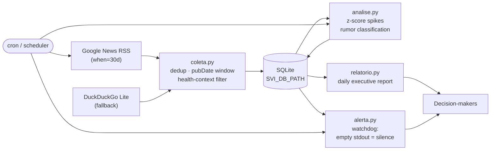

# SVI — Infodemic Surveillance System

> Health misinformation surveillance that runs in production inside a state
> health department in the Brazilian Amazon.

[](https://github.com/MVMLima/infodemia-svi/actions/workflows/ci.yml)
[](https://github.com/MVMLima/infodemia-svi/actions/workflows/docker-publish.yml)
[](LICENSE)
[](https://www.python.org/)
[](#design-decisions)

---

## The problem this solves

During a vaccination campaign, a rumor can grow for a week before anyone with a
mandate to respond notices it. Health teams have no systematic signal: nobody
knows whether a claim is spreading or dying, so they either react late or react
to noise.

Monitoring private messaging groups is technically infeasible and legally
risky. **So this system builds a defensible, auditable public signal instead** —
an early-warning layer on indexed public news mentions, with every alert
traceable to the articles that caused it.

It is not a fact-checking engine. It is a screening system that decides what
deserves a human's attention today.

---

## Architecture



Four stages, each independently runnable and testable:

| Stage | Script | What it does |
|---|---|---|
| 1. Collect | `coleta.py` | Pulls mentions, dedups by title, discards anything outside the window using the article's real `pubDate`, scores sentiment (PT-BR keyword matching) |
| 2. Analyse | `analise.py` | Computes z-score against a rolling baseline, flags circulation spikes, classifies rumors against a seeded knowledge base |
| 3. Report | `relatorio.py` | Markdown executive report: summary, 7d vs previous 7d, volume per term, daily series, new articles with real outlet names, spikes, rumors, replacement narratives |
| 4. Alert | `alerta.py` | Watchdog: prints nothing when there is no signal, so a scheduler only wakes a human when something changed |

---

## Quick start

### Docker (recommended for servers)

```bash
docker build -t infodemia-svi .
docker run --rm -v svi-data:/data infodemia-svi          # full pipeline
docker run --rm -v svi-data:/data infodemia-svi python3 scripts/alerta.py
```

Or pull the published image:

```bash
docker pull ghcr.io/mvmlima/infodemia-svi:latest
```

### Local, no installation

The pipeline has **no dependencies** — Python 3.9+ standard library only.
There is nothing to `pip install` and no virtualenv required.

```bash
git clone https://github.com/MVMLima/infodemia-svi.git
cd infodemia-svi
export PYTHONPATH=$PWD/scripts

bash run_pipeline.sh          # init_db -> collect -> analyse -> report
```

Step by step:

```bash
export PYTHONPATH=$PWD/scripts

python3 scripts/init_db.py       # 1. SQLite schema (idempotent)
python3 scripts/coleta.py        # 2. collect mentions (stdout = JSON summary)
python3 scripts/analise.py       # 3. detect spikes, classify rumors
python3 scripts/relatorio.py     # 4. markdown report (stdout)
python3 scripts/alerta.py        # 5. watchdog (empty output = no alert)

python3 scripts/marcar_exibidas.py   # after delivering a briefing, so the
                                     # next report does not repeat items
```

---

## Configuration

`scripts/config.json`:

| Key | Default | Meaning |
|---|---|---|
| `regiao` | `"Acre"` | Region appended to searches — change this to run it anywhere |
| `termos` | 10 vaccine/pandemic terms | Monitored terms |
| `limiar_zscore` | `2.0` | z-score threshold for `ALERTA` |
| `janela_media` | `7` | Rolling baseline window |
| `janela_dias` | `30` | Search and reporting period, in days |
| `max_resultados_por_termo` | `10` | Max results per term, per source |

**Database location**, in order of precedence:
`SVI_DB_PATH` env var → `db_path` in `config.json` → `data/infodemia.db`.

The env var exists so the same code runs in development, in CI and in
production without editing files.

---

## Running in production

The system was designed for cron, not for a daemon:

```cron
50 6 * * *  PYTHONPATH=$PWD/scripts python3 scripts/coleta.py   # collect
                                    && python3 scripts/analise.py  # analyse
0  7 * * *  PYTHONPATH=$PWD/scripts python3 scripts/alerta.py     # silent watchdog
10 7 * * *  PYTHONPATH=$PWD/scripts bash scripts/cron_relatorio.sh # report
```

The watchdog pattern matters: `alerta.py` prints **nothing** when there is no
signal. The scheduler only escalates to a human when something actually moved,
which is the difference between a system that gets read and a system that gets
muted.

---

## Design decisions

**Zero external dependencies.** Not minimalism for its own sake — the target
environment is a public-sector workstation where installing packages is either
blocked or a bureaucratic process. A surveillance tool that needs a virtualenv
never gets deployed. Using `urllib`, `sqlite3`, `json` and `xml.etree` was the
requirement.

**Data quality before statistics.** The Google News RSS feed happily returns
articles from months ago. Naive collection inflates the "today" count with old
news and produces fake spikes. Every item is filtered against its real
`pubDate`, and the dedup runs on title.

**A minimum baseline before alerting.** On a sparse series, a single mention
after two quiet days looks like an enormous z-score. The system requires a
minimum baseline (≥4 days with mentions) before an `ALERTA` can fire. This
trades sensitivity for specificity on purpose — see limitations.

**Fact-checks are tracked but do not count as spread.** A fact-checking article
("É #FAKE...") is classified for traceability but excluded from propagation.
Without this rule, the act of debunking inflates the very indicator you are
measuring.

**Rumors ship with replacement narratives.** An alert that only says "a rumor
exists" is not actionable for a communications team. Each seeded rumor carries a
counter-narrative and official sources, ready to use.

---

## Limitations

Declared openly, because a surveillance system that hides its blind spots is
worse than none:

- **Only indexed public mentions.** WhatsApp, Telegram groups and closed
  communities are not captured. An outbreak starting in private groups may never
  appear here.
- **Keyword matching is heuristic.** Single-word keywords match on word
  boundaries ("mata" will not match "mata-mata"), but this remains a heuristic.
  At larger scale, a PT-BR BERT model would be the right tool.
- **Sensitivity/specificity trade-off is real and measured.** A documented case:
  a spike on 2026-08-02 (91 mentions, 53% above baseline) did **not** raise an
  alert because the minimum baseline was not met, while the alert on 2026-08-22
  (z=2.50, national vaccination day) was correct. The false negative is a known
  consequence of a short baseline window, not a bug.

---

## Tests

48 unit tests, offline, temporary database per test — no network access and no
external dependencies to install.

```bash
PYTHONPATH=$PWD/scripts python3 -m unittest discover -s tests -v
# Ran 48 tests ... OK
```

CI runs the suite on every push across Python 3.9 and 3.12.

---

## License

MIT — see [LICENSE](LICENSE).

Documentação em português: [README.pt-BR.md](README.pt-BR.md)
